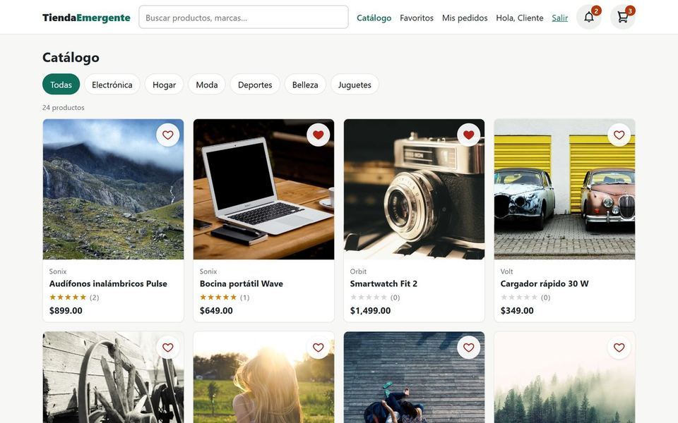
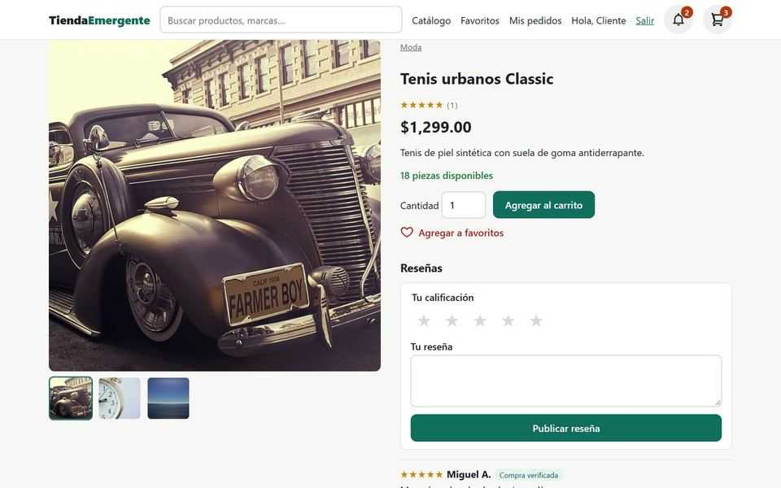
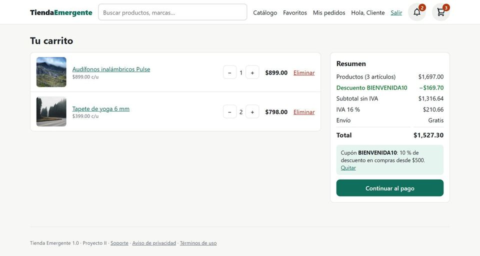
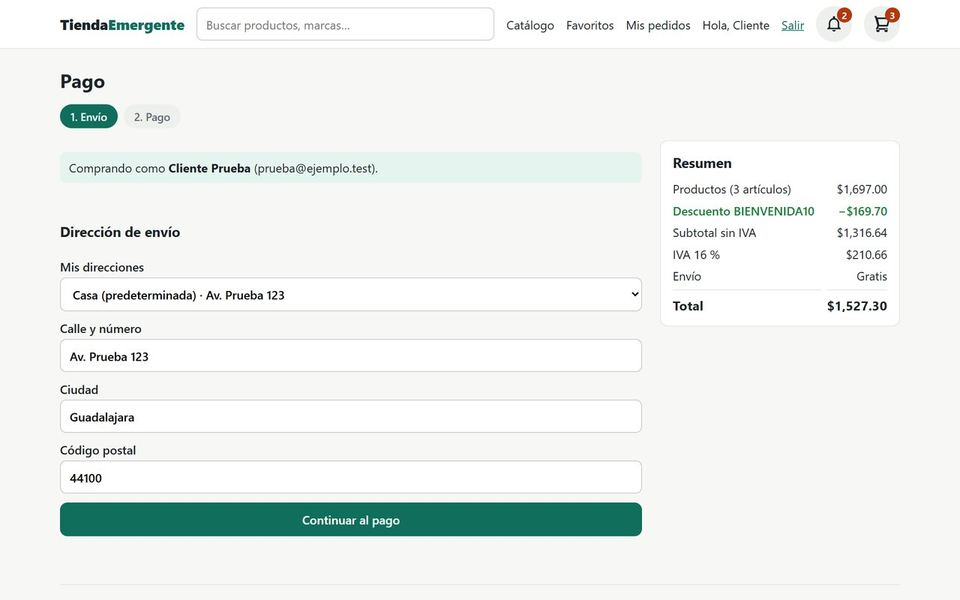
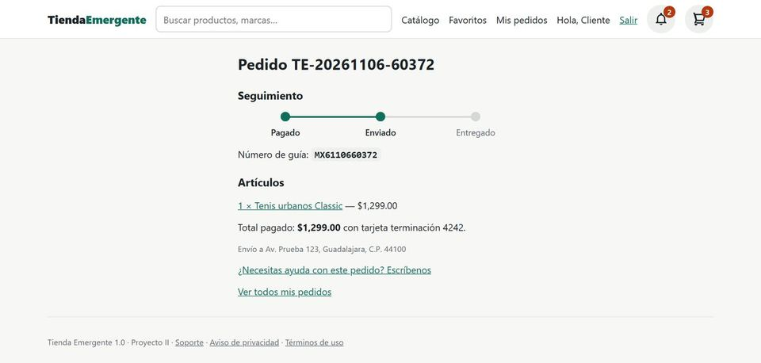
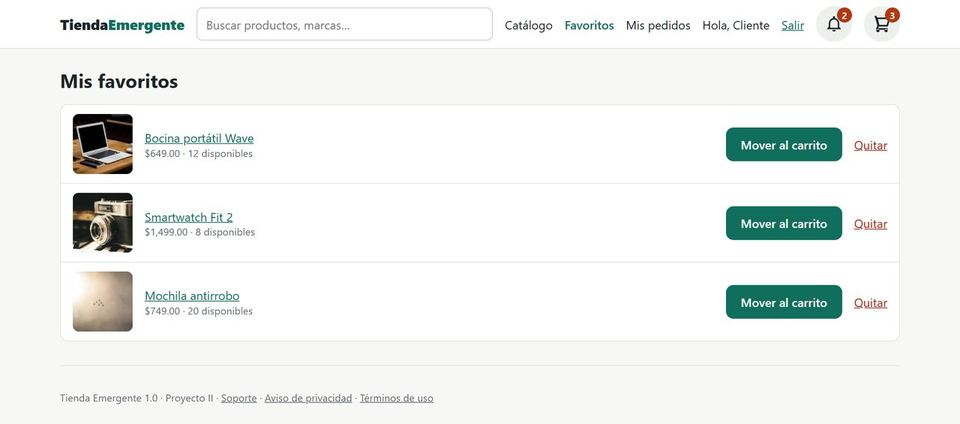
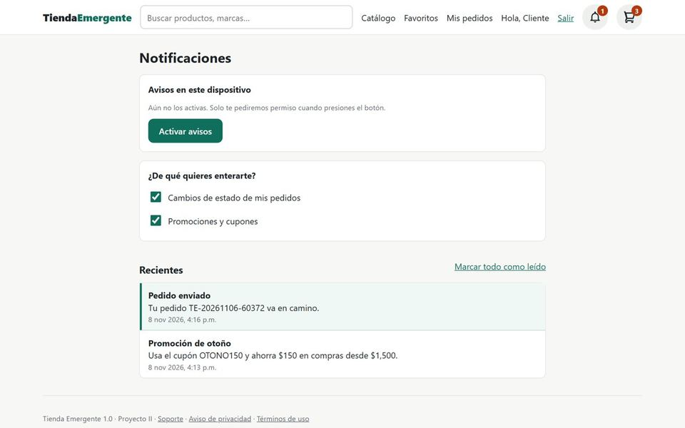
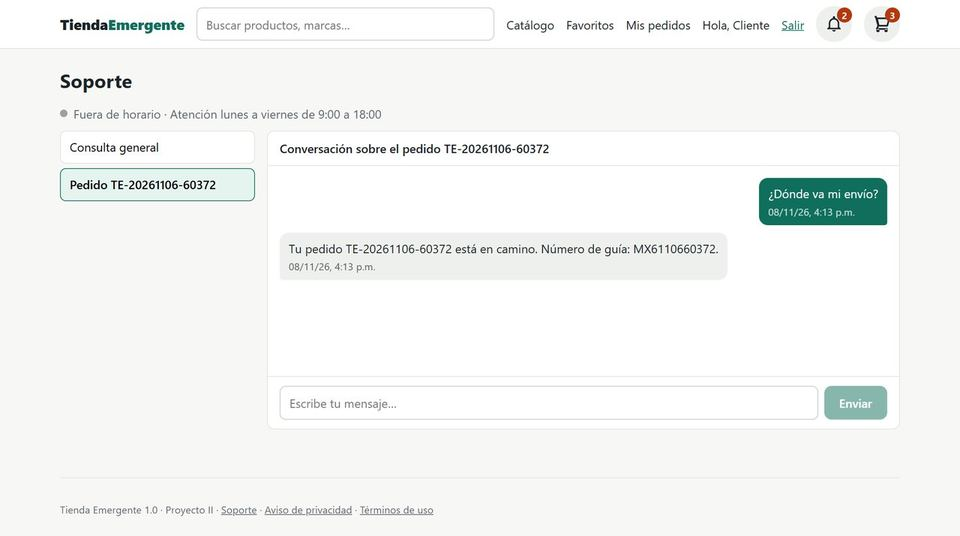
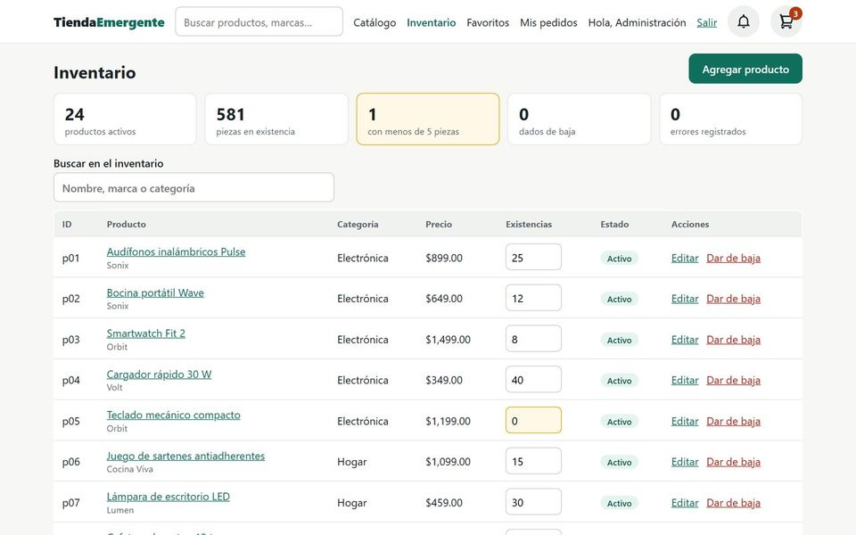

# Manual de uso · Tienda Emergente 1.0

Guía breve para comprar en la tienda y para administrar el inventario. App en línea:
https://qbone-dev.github.io/tienda-emergente-react/

> Versión de demostración: los pagos, el inicio de sesión con Google y Facebook, los correos, la paquetería y los
> asesores del chat están simulados. Ningún pedido genera cargos ni envíos reales. Los datos se guardan solo en tu
> navegador; puedes borrarlos desde el [Aviso de privacidad](https://qbone-dev.github.io/tienda-emergente-react/#/privacidad).

## Para el comprador

### 1. Encontrar un producto
En el **Catálogo** elige una categoría o escribe en la barra de búsqueda; la búsqueda entiende errores de escritura
(«audifnos» encuentra «Audífonos»). En la página de resultados puedes filtrar por categoría, marca y precio.
El corazón de cada tarjeta guarda el producto en **Favoritos** (requiere iniciar sesión).

### 2. Ver el detalle y agregar al carrito
El detalle muestra la galería (pasa el cursor sobre la foto para acercar), las existencias y las reseñas. Elige la
cantidad y presiona **Agregar al carrito**. Si compraste el producto, ahí mismo puedes calificarlo de 1 a 5 estrellas.

### 3. Carrito y cupones
Cambia cantidades con **−** y **+** o elimina productos. Escribe tu cupón y presiona **Aplicar**: el descuento aparece
como renglón en el resumen. Cupones de prueba: `BIENVENIDA10` (10 % desde $500), `OTONO150` ($150 desde $1,500, del
15/10 al 15/11) y `ENVIOGRATIS` (desde $300, en octubre). El envío es gratis desde $999 después del descuento.

### 4. Pagar
**Continuar al pago** abre dos pasos: envío y pago. Puedes comprar sin cuenta (como invitado) con solo tu correo y tu
dirección; si tienes sesión, se llena tu dirección predeterminada. El botón **Regresar** y el «atrás» del navegador
conservan lo que escribiste. Tarjeta de prueba: `4242 4242 4242 4242`, cualquier fecha futura y CVV `123`.

### 5. Seguir tu pedido
Al pagar recibes un número de pedido. En **Mis pedidos** ves todos tus pedidos; cada uno muestra la línea de tiempo
Pagado → Enviado → Entregado y el número de guía cuando sale.

### 6. Favoritos, avisos y perfil
- **Favoritos:** mueve un producto guardado al carrito con un clic.
- **Notificaciones** (campana): avisos de cada cambio de estado de tus pedidos y, si lo eliges, de promociones.
  Presiona **Activar avisos** para recibirlos también como notificación del navegador.
- **Mi perfil** (tu nombre en el encabezado): cambia tu nombre y administra tus direcciones de envío.

### 7. Soporte
En **Soporte** (pie de página o «¿Necesitas ayuda con este pedido?») hay una conversación general y una por cada
pedido. La atención es de lunes a viernes de 9:00 a 18:00; fuera de ese horario tu mensaje queda guardado.

## Para el administrador

Entra con el correo `admin@tiendaemergente.mx` y la contraseña que te entregue el responsable del proyecto (no está
en el repositorio). El enlace **Inventario** aparece en el encabezado.

- Los indicadores muestran productos activos, piezas en existencia, productos con menos de 5 piezas y errores registrados.
- **Agregar producto** abre el formulario de alta (nombre, marca, categoría, precio con IVA y existencias).
- Para cambiar existencias, escribe el número en la tabla y presiona **Guardar**: la tienda lo muestra al instante.
- **Dar de baja** oculta el producto de la tienda sin borrarlo; **Reactivar** lo devuelve.

## Instalar la app

En Chrome o Edge, abre el menú del navegador y elige **Instalar Tienda Emergente** (en el teléfono, «Agregar a la
pantalla de inicio»). La app instalada abre incluso sin conexión.
